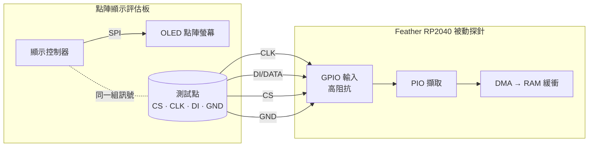

# 2nd-screen — 被動把點陣顯示匯流排鏡到第二螢幕

一片 Feather RP2040 被動高阻抗搭在點陣顯示**評估板**的「控制器 → OLED」SPI 匯流排上（四條線：DI/CLK/CS/GND），把匯流排位元組串流回主機；主機端把它重建成 framebuffer，即時鏡像成評估板的**第二螢幕**。

探針全程**只讀、不驅動任何線**。這既是「替點陣顯示器外掛第二螢幕」的小工具，也說明一件事：**可及的明文顯示匯流排，內容就守不住**。

## 範圍

| 做 | 不做 |
|---|---|
| 高阻抗被動擷取 控制器→OLED 的 SPI | 任何驅動／回寫匯流排的動作 |
| 把位元組流重建成畫面，鏡成第二螢幕 | OCR／內容還原（讀出螢幕上的「文字」） |
| 只用**自有、無敏感內容**的評估板 | 任何「藏進成品」或外傳通道 |

## 安全護欄

1. 裝置是**自有、無敏感內容**的評估板。
2. 探針被動、只讀、不回寫、不接 MISO；唯一共用的電源連線是 `GND`（**不接 +5V**，避免回灌燒件）。
3. RP2040 先 USB 通電再搭線（永不把活匯流排灌進未通電晶片）。
4. 擷取資料不離開評估環境。

## 接線（被動、高阻抗）

只接四條，GPIO 全設輸入，不驅動任何線。



| 訊號 | RP2040 GPIO | Feather 絲印 | 作用 |
|---|---|---|---|
| DI（資料） | GP10 | D10 | IN base |
| CLK（時脈） | GP11 | D11 | IN base + 1（必須與 DI 相鄰） |
| CS（選擇） | GP12 | D12 | frame 邊界（低電位有效） |
| GND | GND | GND | 共地（唯一共用電源線） |

> ⚠ Feather 的「Dn」絲印 ≠ GPIO 編號；GP4 未接出（USBBOOT），GP2/GP3 是 SDA/SCL（可能帶上拉，避開）。選 D10/D11/D12 三支相鄰純數位腳。評估板側的測試點依該板資料手冊／原理圖定位，接前用電表復驗（GND 導通、上電量各點對地電壓辨識訊號線）。

## 擷取端韌體（RP2040 PIO tap）

RP2040 的 PIO：以 CS 為 frame 邊界、在 CLK 取樣邊緣讀 DI，湊成位元組推 FIFO，再 DMA 進緩衝，不占 CPU。

```
; PIO 骨架（概念）：CS 低電位期間，於 CLK 上升緣取樣 DI
.program spi_tap
    wait 0 pin CS          ; 等 CS 拉低（frame 開始）
sample:
    wait 1 pin CLK         ; 等時脈上升緣
    in   pins, 1           ; 取樣 DI 一個位元
    wait 0 pin CLK         ; 等時脈回落
    jmp  sample
```

`spi_tap.c` 把三支探針腳全設輸入、以 OEOVER/OD 硬體鎖成永不驅動（純被動），DMA 收滿一塊（預設 2048 B，低延遲）就經 USB CDC 以 hex 倒出。預設 SPI mode 0；實測極性不同就改 `.pio` 的 `wait` 邊緣。

### 擷取鏈自測（P-1，晶片內 loopback，無外接跳線）

接真評估板前，先確認**擷取鏈本身是對的**（PIO 取樣 ＋ DMA ＋ USB CDC）。做法是同一顆 RP2040「自己驅動、自己擷取同一組腳」，不接跳線、不接目標板：

- `loopback_test.c` 用 **SIO（一般 GPIO 輸出）** 在 GP10/11/12 打一組已知 mode-0 波形（第 _i_ 個位元組 = `i & 0xFF`），再用**與正式韌體同一支** `spi_tap.pio` 把同一組腳當輸入讀回、比對。
- 關鍵事實：RP2040 的 **PIO 輸入永遠接在 pad 的輸入同步器上，與輸出 FUNCSEL 無關**，故 SIO 驅動輸出、PIO 讀輸入可在晶片內 loopback，毋需外部跳線。
- ⚠ `loopback_test` 會把腳設成**輸出**，**絕不可**在接著目標板時燒；只有 `bus_probe` 與 `spi_tap` 是被動的。

```bash
ninja -C poc/build/spi-tap loopback_test
picotool load -x -f poc/build/spi-tap/loopback_test.uf2
python3 poc/host/usb_probe.py --read 8
```

**實測（Feather RP2040，本機）**[證實]：連續多 round 全 `PASS`，每 round **16384/16384 位元組零不符**，擷取開頭 `00 01 02 … 1f`，與驅動端一致。

```
# loopback_test ready (DI=GP10 CLK=GP11 CS=GP12) — on-chip self-test, no jumper
round 0: PASS  (0/16384 bytes mismatch)
  head: 00 01 02 03 04 05 06 07 08 09 0a 0b 0c 0d 0e 0f 10 11 12 13 14 15 16 17 18 19 1a 1b 1c 1d 1e 1f
```

結論：**PIO 取樣（mode-0、CS 為 frame 邊界、MSB-first autopush）＋ DMA ＋ USB CDC 這條擷取鏈端到端正確。** 自測後重燒回 `spi_tap.uf2`。

<!-- answer: P-1 -->

## 主機端重建：第二螢幕

位元組流依一般點陣 OLED 控制器的「欄定址＋每欄 8 垂直像素」佈局重建 128×64 framebuffer，印成半格 ASCII。

- `live_mirror.py`：**即時第二螢幕**——邊收串流邊重建，終端原地重繪；評估板切畫面，鏡像同步跟著變。`--page` 改用頁命令對齊；`--file <cap>` 重播擷取檔。
- `raster.py`：把單一擷取檔還原成一張靜態畫面。

> ⚠ 四線（DI/CLK/CS/GND）**不含 D/C（資料／命令）線**，故位元組流中命令與像素未硬分；但像素佔絕大宗（每幀約 1024 B vs 數個命令位元組），以非零密度對齊即可看出畫面。頁/欄 opcode 的精確對齊以實際擷取為準。

## 量測與真機結果

沒有示波器也能定案：`bus_probe.c` 讓 RP2040 用**真正的輸入門檻**硬體計 CLK 上升緣——「數得到邊緣」直接等於「正式 tap 讀得到」。純被動，可安全搭在活匯流排上。每秒一行：`# alive  CLK rising/s=<n> (total=<n>)  sample DI=<0/1> CLK=<0/1> CS=<0/1>`。

**量測記錄**（bus_probe + spi_tap，評估板）

| 量測 | 值 | 備註 |
|---|---|---|
| CS 對地（DC 電表） | `3.6V`[證實] | idle-high |
| CLK 對地（DC 電表） | `1.8V`[證實] | 1.8V 訊號 |
| `sample CS`（開機、靜態） | `1`[證實] | idle-high，證明探針有接、共地正常 |
| `CLK rising/s`：靜態畫面 | `0`[證實] | write-on-change：靜態不 clocking |
| `CLK rising/s`：切換畫面 | `8312`/重繪（峰 `16624`）[證實] | 每次重繪一突發，total 單調累積 2.03M→2.18M |
| 真擷取（spi_tap，切畫面 32s） | `12,480 B`[證實] | 垂直欄打包；`raster.py` 還原出可辨識畫面字形 |

**實跑經過**（host build：`brew install picotool ninja`、`~/pico-sdk` shallow clone + tinyusb、cmake/ninja；`picotool load -x -f` 軟體進 BOOTSEL 成功）：

1. **評估板關機時**：三線恆 0、零邊緣——因匯流排無人驅動（非接線問題）。排除接線假設的關鍵：開機後 `sample CS` 立刻讀到 `1`。
2. **評估板開機**：靜態 `rising/s=0`、`CS=1`；切畫面時 `rising/s` 跳到 **8312/重繪**（峰 16624），`total` 單調累積。**結論：1.8V CLK 跨得過 RP2040 門檻、讀得到；且為 write-on-change。** 每次重繪約 8312 邊緣 ≈ 一張 128×64 全畫面（8192 bit）。**→ 不需電平轉換。**
3. **真擷取**：block 由 16384 調小到 2048 B（bench／第二螢幕低延遲），切畫面擷得 **12,480 B** 原始垂直欄像素，`raster.py` 以 128 欄 × 頁重繪，**肉眼可讀出評估板畫面字形**——被動搭四線即可即時旁觀顯示內容，**於真機證實**。

| 觀察到 | 結論 |
|---|---|
| 切畫面時 `rising/s` **跳起來**、靜態歸零 | 讀得到，且為 write-on-change（→ 第二螢幕可行） |
| 畫面更新但 `rising/s` **一直 0** | 準位太低（1.8V < V_IH）或接觸問題 → 加電平轉換/比較器 |
| 靜態也**持續很高** | 連續刷新（無 GDDRAM）→ 改連續資料率模型 |

<!-- answer: P-2 -->
<!-- answer: P-4 -->

## 資料率與刷新模型

只搭到「控制器寫入」這一種流量；面板自身的連續掃描在控制器內部，不上 SPI 線。本機實測為 **write-on-change**（靜態 `rising/s=0`，切畫面才突發）——即控制器自帶顯示記憶體（GDDRAM）：

- 一張全幀 128×64 ＝ 1024 B 像素 ＋ 少量頁指令 ≈ **~1 KB**，與實測「每次重繪約 8312 邊緣 ≈ 8192 bit」相符。
- 其餘時間匯流排閒置；真機若為局部更新（只重畫變動區），每次突發只會**更小**——第二螢幕只會更輕鬆。
- 取樣餘裕：PIO 可達 sysclk（125 MHz），對上幾 MHz 的匯流排遠非瓶頸。

## demo run-of-show（第二螢幕）

把這個做成一場 **10 分鐘 demo**：讓看的人親眼看到「碰得到顯示線 → 畫面被旁人的終端照抄」。house style：reveal 是**終端機畫面**，現場跑 `live_mirror.py`。

### Run of show

| # | 拍子 | 現場動作 | 螢幕上出現什麼 | 時間 |
|---|---|---|---|---|
| 1 | **定場** | 一片評估板、一片 Feather RP2040、四條杜邦線。 | 投影片：接線示意（上文 mermaid）。 | 1.5 分 |
| 2 | **搭線** | 指出評估板的 CS/CLK/DI/GND 測試點，接上被動探針。**預錄**。 | 預錄終端：`usb_probe.py` 回報 `RUNNING`，板子只是被動聽。 | 1.5 分 |
| 3 | **第二螢幕（高潮）** | 跑 `live_mirror.py`，在評估板上切畫面。**現場跑**，決定性、可重播。 | 終端裡的 ASCII 螢幕**同步跟著評估板一起變**。 | 3 分 |
| 4 | **轉折** | 收手：這是**被動**的、只讀、不回寫，評估板毫不知情。 | 投影片：被動搭線為何擋不住。 | 2 分 |
| 5 | **防護** | 落到設計：顯示路徑碰得到就守不住，怎麼辦？ | 下方「防護收尾」。 | 2 分 |

### 第二螢幕（第 3 拍，現場跑）

```bash
picotool load -x -f poc/build/spi-tap/spi_tap.uf2
python3 poc/host/live_mirror.py        # 畫面橫移嚴重時加 --page
```

喚醒評估板、切畫面，終端裡的 128×64 ASCII 螢幕就跟著重繪。節奏：先停在靜態畫面（鏡像定格），再開始切（觀眾意識到「它真的同步讀到了」）。

### 預錄 vs 現場 / fallback

分界原則：**實體、易出包的錄起來；軟體、決定性的現場跑。**

| 段落 | 預錄 | 現場 | 為什麼 |
|---|---|---|---|
| 搭線、接探針（第 2 拍） | ✅ | | 焊線／夾針現場做又慢又易接觸不良。 |
| 第二螢幕（第 3 拍） | 備一份錄影 | ✅ **優先現場** | 純軟體、決定性、可重播——現場跑最有說服力。 |
| 轉折與防護（第 4、5 拍） | | ✅ | 口頭＋投影片。 |

fallback，由硬到軟：

1. **現場鏡像不出畫面**（裝置睡著／接觸不良）→ 改放**預錄鏡像錄影**。
2. **連預錄都放不出來** → 跑 `raster.py --file <擷取檔>` 把一張已擷取畫面靜態還原出來。
3. **被質疑「是不是接線作弊」** → 回放 P-1 的 on-chip loopback（`loopback_test`，無跳線、同板自驅自讀 `PASS`），證明擷取鏈本身可信。

### 防護收尾

攻擊面是**可及的明文顯示鏈**；防線有三層，擇一或疊加：

1. **納入安全邊界**：控制器直驅顯示、走線不可及（無測試點／可拆接頭）。
2. **顯示鏈加密 / MAC**：被動擷取只拿到密文。
3. **物理防護 + 開殼偵測**：關鍵走線埋內層／灌膠／防拆網，碰線留痕或觸發；外殼⇄主板配對。

> 這份 run of show 是 P-6（預錄＋排練）與 P-7（實演）的腳本底稿。

<!-- answer: P-5 -->
