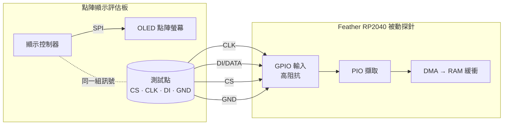

# 2nd-screen — 被動把點陣顯示匯流排鏡到第二螢幕

一片 Feather RP2040 被動高阻抗搭在點陣顯示**評估板**的「控制器 → OLED」SPI 匯流排上（四條線：DI/CLK/CS/GND），把匯流排位元組串流回主機；主機端把它重建成 framebuffer，即時鏡像成評估板的**第二螢幕**。

現有探針全程**只讀、不驅動任何線**。這是「替點陣顯示器外掛第二螢幕」的小工具。

## 範圍

- 高阻抗被動擷取 控制器→OLED 的 SPI
- 把位元組流重建成畫面，鏡成第二螢幕
- 不做主動回寫：這條路線已由使用者決定移除（2026-11-02），舊實作與評估見 commit `5e7149b`

## 安全護欄

1. 探針只讀、不回寫、不接 MISO；唯一共用的電源連線是 `GND`（**不接 +5V**，避免回灌燒件）。
1. RP2040 先 USB 通電再搭線（永不把活匯流排灌進未通電晶片）。

## 接線（被動、高阻抗）

只接四條，GPIO 全設輸入，不驅動任何線。



| 訊號 | RP2040 GPIO | Feather 絲印 | 作用 |
|---|---|---|---|
| DI（資料） | GP10 | D10 | IN base |
| CLK（時脈） | GP11 | D11 | IN base + 1（必須與 DI 相鄰） |
| CS（選擇） | GP12 | D12 | frame 邊界（低電位有效） |
| GND | GND | GND | 共地（唯一共用電源線） |

> ⚠ Feather 的「Dn」絲印 ≠ GPIO 編號；GP4 未接出（USBBOOT），GP2/GP3 是 SDA/SCL（可能帶上拉，避開）。選 D10/D11/D12 三支相鄰純數位腳。評估板側的測試點依該板資料手冊／原理圖定位，接前用電表復驗（GND 導通、上電量各點對地電壓辨識訊號線）。

## 擷取端韌體（RP2040 PIO tap）

RP2040 的 PIO：以 CS 為 frame 邊界、在 CLK 取樣邊緣讀 DI，湊成位元組推 FIFO，再 DMA 進緩衝，不占 CPU。

```
; PIO 骨架（概念）：CS 低電位期間，於 CLK 上升緣取樣 DI
.program spi_tap
    wait 0 pin CS          ; 等 CS 拉低（frame 開始）
sample:
    wait 1 pin CLK         ; 等時脈上升緣
    in   pins, 1           ; 取樣 DI 一個位元
    wait 0 pin CLK         ; 等時脈回落
    jmp  sample
```

`spi_tap.c` 把三支探針腳全設輸入、以 OEOVER/OD 硬體鎖成永不驅動（純被動），DMA 持續收進 32 KiB ring，USB CDC 以 binary 封包傳送（bus 閒置 2 ms 送一包，單包上限 2048 B）；擷取不因 USB 傳送停止。預設 SPI mode 0；實測極性不同就改 `.pio` 的 `wait` 邊緣。

**[證實：Feather RP2040 自測]** 擷取鏈曾以晶片內 loopback 驗證：同一顆 RP2040 用 SIO 打已知 mode-0 波形，再用正式韌體同一支 `spi_tap.pio` 讀回，連續多 round 每 round 16384/16384 B 零不符。結論是 PIO 取樣（mode-0、CS 為 frame 邊界、MSB-first autopush）＋ DMA ＋ USB CDC 這條鏈正確。自測程式已移除，見 commit `de752ed`。

<!-- answer: P-1 -->

## 主機端重建：第二螢幕

位元組流依一般點陣 OLED 控制器的「欄定址＋每欄 8 垂直像素」佈局重建 128×64 framebuffer，印成半格 ASCII。

- `live_mirror.py`：**即時第二螢幕**——邊收串流邊重建，終端原地重繪；預設等待完整 `B0..B7` 頁序列（`--page` 同義），`--raw` 顯示最新 1024 B 的未對齊診斷畫面；`--file <cap>` 重播擷取檔。

> ⚠ 四線（DI/CLK/CS/GND）**不含 D/C（資料／命令）線**，故位元組流中命令與像素未硬分。現版以完整八頁序列核對位置，不依像素密度選幀，也不跳過頁首像素。這是以已觀察格式重建。

**[證實：真機擷取]** 全畫面更新為 `B0 + 128 B`、`B1 + 128 B`，依此至 `B7 + 128 B`；每頁 marker 相距 129 B。重建規則：

- 收到完整八頁才更新；新空白畫面可取代舊畫面。
- 不將孤立 `0xBn` 當頁起點，不跳過 `0x00`、`0x10` 等有效像素。
- 串流 gap 時不跨邊界拼幀，保留上一個完整畫面直到取得新幀。資料相同時不重繪。

**[限制]** 此顯示格式解碼不涵蓋只有局部頁更新或插入欄命令的其他協定。

**[證實：使用者肉眼對照]** 鏡像與實體螢幕的內容、方向一致。128×64 點數少，肉眼足以確認；未做像素級比對。

### 保留被篩掉的資料與時間資訊

**[證實：程式與回歸測試]** `live_mirror.py` 即時執行時，預設將收到的每個 serial chunk **先存檔，再解析**，存至 `_output/captures/mirror-<UTC>-<unique>.bin`。含壞包與退出時未收完的封包；不是終端 ASCII 畫面截圖。可以指定檔名（不覆寫既有檔案）：

```bash
# 分別記錄左右移動游標、screensaver 喚醒兩個情境；Ctrl-C 結束並完成紀錄。
python3 poc/host/live_mirror.py --capture _output/pin-cursor-01.bin
python3 poc/host/live_mirror.py --capture _output/screensaver-wake-01.bin

# 替既有擷取重建診斷紀錄，輸出新檔並保留來源。
python3 poc/host/live_mirror.py --file _output/pin-cursor-01.bin \
  --capture _output/pin-cursor-reviewed-01.bin
```

旁邊的 `<capture>.events.jsonl` 記錄：serial chunk 的檔案 offset／長度／主機相對時間、完整 frame 的匯流排 offset、實際 render 時間，以及在串流 gap、buffer 裁切、退出時**未用於完整 frame 且尚未辨識為命令的 bus bytes**（`unmatched_bus_bytes`，含 `hex`、`bus_offset`、`reason`）。不將這些 bytes 一律判成雜訊或命令；可能包含初始化、其他協定或被截斷的畫面。`transport_noise` 與 `partial_transport_packet` 另留原始 bytes。檔案與事件逐次 flush；收到完整畫面以前亦會存檔。重播紀錄的 `source` 為 `replay`，其時間代表重播速度，不能當成原始擷取時間。

### 已知顯示命令註解

**[證實：擷取格式與重播]** 55.3 秒樣本有 217 個完整畫面；每個畫面前固定 7 B 為 `D5 xx 81 yy A6 C0 A0`，其中此樣本 `xx` 為 `6F/7F/8F/9F`，`yy` 為 `FF`。現於 `.events.jsonl` 以每幀一筆 `display_commands` 記錄這五個 prefix 命令及八個 `B0..B7` page 命令。每個項目包含 `bus_offset`、`length`、原始 `hex`、`opcode`、`parameters`、命令名稱與 `decoded` 欄位。

| 命令 | 事件名稱 | 解碼欄位（SSD1306-compatible profile） |
|---|---|---|
| `D5 xx` | `set_display_clock` | `clock_divider=(xx & 15)+1`、`oscillator_setting=xx>>4` |
| `81 yy` | `set_contrast` | `contrast=yy` |
| `A6` / `A7` | `set_display_mode` | `inverted=false/true` |
| `C0` / `C8` | `set_com_scan_direction` | `direction=ascending/descending` |
| `A0` / `A1` | `set_segment_remap` | `remapped=false/true` |
| `B0..B7` | `set_page_start_address` | `page=0..7` |

命令欄位依 [Solomon Systech SSD1306 datasheet，§9 與 §10.1.16](https://www.orientdisplay.com/wp-content/uploads/2020/11/SSD1306.pdf#page=32)。**[推測／限制]** 匯流排內容相容此命令表，尚未確認實際 controller 型號；事件的 `profile` 記為 `ssd1306-compatible`、`recognition` 記為 `validated-frame-boundary`，不是 D/C 硬體取樣。

只有緊貼完整八頁畫面之前、符合上述完整 7 B grammar 的資料才辨識為 prefix；不在像素 payload 中搜尋 opcode，不跨已知 gap 拼接命令。clock／contrast 參數可變，也接受同組命令的 inverse／reverse／remap 變體；其餘未知或不完整 prefix 仍保留為 unmatched。命令即使未改變 framebuffer 也逐幀記錄；此步為註解，不依命令改變鏡像像素或預測下一個 clock 值。`--raw` 未對齊模式不做命令分類。

### 連續串流韌體

**[證實：建置與程式檢查]** `spi_tap.c` 使用 byte DMA 寫入 32 KiB、自然對齊的循環 buffer。第二條 DMA channel 在 ring 完成時以硬體重啟資料 DMA；IRQ 只計數 ring 次數，不負責即時 rearm。PIO 持續取樣，USB 由主迴圈以 TinyUSB 可用空間非阻塞送出，沒有每 byte `printf`。三條探針仍保持輸入、OEOVER 強制關輸出與 pad OD；不切到 PIO 輸出功能。

- 有資料後等 bus 閒置 2 ms 才送一包；單包原始資料上限 2048 B，最舊 byte 最多等 20 ms，避免慢速資料無限延遲。韌體不解析內容。
- 空閒時每 250 ms 送 status heartbeat；主機／USB 排程不提供硬即時延遲保證。
- ring 接近追上尚未消費資料時，保守丟棄該 backlog，累計 `dropped_total` 並遞增 `loss_epoch`。主機太慢或未連線時不能保證零遺失。
- `stall_events` 計數 PIO RXSTALL sticky flag 的觀察次數；不是精確漏 bit／byte 數。若發生 stall，像素／位元組對齊亦可能失效，不能僅靠清 counter 宣稱已恢復。
- 新讀取 session、sequence／offset 不連續、epoch／drop／stall counter 改變或 CRC resync，才中斷主機組幀；USB 封包邊界不會中斷組幀。

**控制指令與 frame 同一包 [證實：既有擷取]。** 一個 frame 是 1039 B：7 B 控制指令 `D5 xx 81 FF A6 C0 A0`，加 8 ×（1 B 頁指令 + 128 B 像素）。它們在同一段連續傳輸裡，閒置切包自然合成一包：真機約 9.6 fps 的 290 包全為 1039 B；另一次擷取有 1 包 1063 B，是開頭多 24 B 初始化指令（`AE 00 10 B0 …`）再接 frame。`xx` 在樣本中有 `6F/7F/8F/9F` 四種值，所以這 7 B 不是完全固定，也不另外省略：每 frame 最多只省約 15 B，卻會失去逐 byte 無損。

線上有兩種封包，little-endian，32-bit counters／時間會回繞：

- **data**（開銷 12 B）：8 B header `<2sBBHH`，依序為 `S3`、flags（bit1=RLE）、sequence 低 8 位、線上 payload 長度、offset 低 16 位；後接 payload 與 4 B IEEE CRC32。不帶 device timestamp，事件中 `device_us` 為 null。
- **status**（固定 36 B）：32 B header `<4sBBHIIIIII`，依序為 `STP2`、type（2=status）、flags（bit0=session start）、長度 0、packet sequence、device timestamp（us）、device byte offset、loss epoch、dropped total、stall events；後接 4 B CRC32。magic 沿用舊字串。session 開始、epoch 改變（所有 drop／stall／重連都會遞增）時先送 status 才送下一包 data。

host 以最近狀態加低位元還原完整 sequence／offset，不連續時中斷組幀。device offset 含已知 ring 丟棄 bytes，且總是按解壓後的原匯流排 byte 數計算；診斷裡的 host `bus_offset` 則只計已交付解碼的 bytes，兩者須區分。

壓縮僅使用 byte-run coding，每包獨立解碼，無上一包字典或上一張 framebuffer 依賴：

- flags bit1 (`0x02`) 表示 RLE。RLE payload 前 2 B 是 little-endian 原始長度（1..2048），後接 runs。
- tag `0..127`：後接 `tag+1` 個 literal bytes。
- tag `128..255`：後接一個 byte，重複 `(tag & 127)+3` 次（3..130）。
- 包含 2 B 原始長度後仍小於 raw payload 才壓縮，否則送 raw；無法壓縮的內容不膨脹。
- CRC 先檢查線上 bytes，再做有長度上限的解壓；格式／CRC 壞包會中斷組幀。
- host `stream_packet.payload_length` 為解壓後的原長度，`wire_payload_length` 為線上長度，`compressed` 標記有無 RLE。原始 capture 仍保存線上 bytes，解壓發生於匯流排解碼之前。

capture 是逐 byte 原始存檔，副檔名不決定格式；terminal ASCII 僅是顯示層。`usb_probe.py --read` 可讀 hex／status，**不是**原始 binary 存檔方式。重播請用 `live_mirror.py --file <capture>`。

主機 status bar 第二、三行顯示（第三行僅 live；終端需至少 37 列）：

```text
compression saved% min/max/avg=77.8/91.9/87.0
rate(2s) wire=10.6 kbit/s (1.32 kB/s)  bus=80.2 kbit/s
```

第一行是**節省百分比**，越高越好。min/max 是開啟此 capture 後有效 data 包的最低／最高節省率，包含每包 12 B 開銷：`100 × (1 − (12 + wire_payload_length)/(12 + payload_length))`。avg 涵蓋所有 data 包、以累計原封包 byte 數加權，不是各包百分比的算術平均。raw 算 0%，所以真的出現 1–4 B 的短傳輸時 min 會是 0。status 與壞包不計；尚未收到 data 時 min 顯示初值 `100.0`、max／avg 顯示 `--`。數據累計至這次 host process／重播結束，不因串流 gap 重置。

rate 是最近 2 秒的流量，以固定 2 秒為分母，因此開始的前 2 秒是逐步爬升。`wire` 是實際從序列埠讀到的 bytes，含 header、heartbeat 與壞包；`bus` 是解壓後交付解碼的匯流排 bytes。與 UART 比較時請看 kB/s：9600 baud 8N1 每 byte 佔 10 bits，上限是 960 B/s，不是 9.6 kbit/s 的資料量。`--file` 重播是全速讀檔，不顯示 rate。

TTY 在畫面像素未改變或等待第一個畫面時仍每 250 ms 更新 status，不重繪 framebuffer，也不增加 `updates` 計數。每次結束時在 `.events.jsonl` 加入 `compression_summary`（data 包數、原／線上封包 bytes 及 min/max/avg）；live 另加 `rate_summary`（總 bytes 與 wire／bus 的平均、尖峰 B/s）。

**[證實：真板擷取]** 目前韌體經 picotool flash verification，USB product 為 `SPI Stream v3 Frame`。`_output/captures/mirror-20261101T164415Z-576a5b.txt` 共 455.6 秒、1,768 個 data 包，每包都是 1039 B；無 CRC／header 錯誤，除開頭 session-start 外無 stream gap，`stall_events` 為 0，`dropped_total` 全程不變（連線前丟棄的量不計）。最忙的 30 秒有 290 個 frame（約 9.67 fps）、1.43 kB/s（148 B/frame）；全程單 frame 為 80–452 B、平均 140 B，min/max/avg 為 `57.0/92.4/86.7`。此為這次畫面／負載的量測，不是任意 SPI 負載的保證；流量仍超過 9600 baud 8N1 的 960 B/s，約 1.4 kB/s 也不是 Bluefruit 的實測吞吐量。UART／BLE bridge 仍待實作與量測，資料見 [`bluefruit-ble.md`](bluefruit-ble.md)。

**host 開埠不可清輸入 [證實：對照實驗]。** `tty.setraw` 預設的 `TCSAFLUSH` 會丟掉韌體開埠後立刻送出的 session-start status（4／4 次遺失，`TCSANOW` 為 4／4 次收到）。data 包不帶 epoch／drop 狀態，高負載下又沒有 heartbeat，丟掉它 host 就不知道這些狀態，所以 `live_mirror.py` 用 `TCSANOW`。

### 下一步候選：跨包串流壓縮（未實作）

**[推測：離線模型，未上板]** 每包獨立的 RLE 無法參照上一張畫面。視窗要大於一個 frame（1039 B）才有效，所以下表 2 KB 起明顯改善。以下每 frame 含 36 B 開銷，換成現行 12 B 時每 frame 再少 24 B：

| 方案（每 frame 一包） | B/frame | RAM |
|---|---:|---|
| LZ4 1 KB 視窗 | 194 | 可行 |
| LZ4 2 KB 視窗 | 138 | 可行 |
| **LZ4 4 KB 視窗** | **113** | 視窗可共用 32 KB ring，另需 hash 表 |
| heatshrink 2 KB 視窗 | 205 | 可行，但不划算 |
| DEFLATE 4 KB 視窗 | 105 | 約 20 KB，CPU 較重 |

建議 LZ4 4 KB：換算現行開銷約 89 B/frame，9.6 fps 下約 0.86 kB/s，才低於 960 B/s，但餘裕很小。此數字偏樂觀：模型每次比對最多 32 個候選，快速版 LZ4 通常只比對一個；也未計定期重置字典的成本。代價是掉一包後要到字典重置才能解碼，走 UART／BLE 時必須定期重置。CPU 只有粗估（125 MHz 下平均每 byte 約 12,000 cycle），要上板實測。重新評估可用 `_output/captures-s3/` 的匯流排資料。

## 量測與真機結果

沒有示波器也能定案：`bus_probe.c` 讓 RP2040 用**真正的輸入門檻**硬體計 CLK 上升緣——「數得到邊緣」直接等於「正式 tap 讀得到」。純被動，可安全搭在活匯流排上。每秒一行：`# alive  CLK rising/s=<n> (total=<n>)  sample DI=<0/1> CLK=<0/1> CS=<0/1>`。

**量測記錄**（bus_probe + spi_tap，評估板）

| 量測 | 值 | 備註 |
|---|---|---|
| CS 對地（DC 電表） | `3.6V`[證實] | idle-high |
| CLK 對地（DC 電表） | `1.8V`[證實] | DC 讀值；不等於已確認的數位訊號振幅 |
| `sample CS`（開機、靜態） | `1`[證實] | idle-high，證明探針有接、共地正常 |
| `CLK rising/s`：靜態畫面 | `0`[證實] | write-on-change：靜態不 clocking |
| `CLK rising/s`：切換畫面 | `8312`/重繪（峰 `16624`）[證實] | 每次重繪一突發，total 單調累積 2.03M→2.18M |
| 真擷取（spi_tap，切畫面 32s） | `12,480 B`[證實] | 垂直欄打包；還原出可辨識畫面字形 |

**實跑經過**（host build：`brew install picotool ninja`、`~/pico-sdk` shallow clone + tinyusb、cmake/ninja；`picotool load -x -f` 軟體進 BOOTSEL 成功）：

1. **評估板關機時**：三線恆 0、零邊緣——因匯流排無人驅動（非接線問題）。排除接線假設的關鍵：開機後 `sample CS` 立刻讀到 `1`。
2. **評估板開機**：靜態 `rising/s=0`、`CS=1`；切畫面時 `rising/s` 跳到 **8312/重繪**（峰 16624），`total` 單調累積。**結論：本次接線能取樣 CLK；更新行為符合 write-on-change。** 每次重繪約 8312 邊緣 ≈ 一張 128×64 全畫面（8192 bit）。DC 電表 1.8 V 不等於已確認的訊號振幅。
3. **真擷取**：切畫面擷得 **12,480 B** 原始垂直欄像素，以 128 欄 × 頁重繪，**肉眼可讀出評估板畫面字形**——被動搭四線即可即時旁觀顯示內容，**於真機證實**。

| 觀察到 | 結論 |
|---|---|
| 切畫面時 `rising/s` **跳起來**、靜態歸零 | 讀得到，且為 write-on-change（→ 第二螢幕可行） |
| 畫面更新但 `rising/s` **一直 0** | 準位太低（1.8V < V_IH）或接觸問題 → 加電平轉換/比較器 |
| 靜態也**持續很高** | 連續刷新（無 GDDRAM）→ 改連續資料率模型 |

<!-- answer: P-2 -->
<!-- answer: P-4 -->

## 資料率與刷新模型

只搭到「控制器寫入」這一種流量；面板自身的連續掃描在控制器內部，不上 SPI 線。本機實測為 **write-on-change**（靜態 `rising/s=0`，切畫面才突發）——即控制器自帶顯示記憶體（GDDRAM）：

- 一張全幀 128×64 ＝ 1024 B 像素 ＋ 少量頁指令 ≈ **~1 KB**，與實測「每次重繪約 8312 邊緣 ≈ 8192 bit」相符。
- 其餘時間匯流排閒置；真機若為局部更新（只重畫變動區），每次突發只會**更小**——第二螢幕只會更輕鬆。
- 取樣餘裕：PIO 可達 sysclk（125 MHz），對上幾 MHz 的匯流排遠非瓶頸。


## demo run-of-show（第二螢幕）

把這個做成一場 **10 分鐘 demo**：讓看的人親眼看到「碰得到顯示線 → 畫面被旁人的終端照抄」。reveal 是**終端機畫面**，現場跑 `live_mirror.py`。這份是 P-6（預錄＋排練）與 P-7（實演）的腳本底稿。

| # | 拍子 | 現場動作 | 螢幕上出現什麼 | 時間 |
|---|---|---|---|---|
| 1 | **定場** | 一片評估板、一片 Feather RP2040、四條杜邦線。 | 投影片：接線示意（上文 mermaid）。 | 1.5 分 |
| 2 | **搭線** | 指出評估板的 CS/CLK/DI/GND 測試點，接上被動探針。**預錄**。 | 預錄終端：`usb_probe.py` 回報 `RUNNING`，板子只是被動聽。 | 1.5 分 |
| 3 | **第二螢幕（高潮）** | 跑 `live_mirror.py`，在評估板上切畫面。**現場跑**，決定性、可重播。 | 終端裡的 ASCII 螢幕**同步跟著評估板一起變**。 | 3 分 |
| 4 | **轉折** | 收手：這是**被動**的、只讀、不回寫，評估板毫不知情。 | 投影片：被動搭線為何擋不住。 | 2 分 |
| 5 | **防護** | 落到設計：顯示路徑碰得到就守不住，怎麼辦？ | 下方「防護收尾」。 | 2 分 |

第 3 拍現場：

```bash
picotool load -x -f poc/build/spi-tap/spi_tap.uf2
python3 poc/host/live_mirror.py
```

喚醒評估板、切畫面，終端裡的 128×64 ASCII 螢幕就跟著重繪。節奏：先停在靜態畫面（鏡像定格），再開始切（觀眾意識到「它真的同步讀到了」）。

分界原則：**實體、易出包的錄起來；軟體、決定性的現場跑。** 搭線（第 2 拍）預錄；第二螢幕（第 3 拍）優先現場並備一份錄影；第 4、5 拍是口頭＋投影片。

fallback，由硬到軟：

1. **現場鏡像不出畫面**（裝置睡著／接觸不良）→ 改放預錄鏡像錄影。
2. **連預錄都放不出來** → 跑 `python3 poc/host/live_mirror.py --file <擷取檔>` 重播已擷取畫面。

### 防護收尾

攻擊面是**可及的明文顯示鏈**；防線有三層，擇一或疊加：

1. **納入安全邊界**：控制器直驅顯示、走線不可及（無測試點／可拆接頭）。
2. **顯示鏈加密 / MAC**：被動擷取只拿到密文。
3. **物理防護 + 開殼偵測**：關鍵走線埋內層／灌膠／防拆網，碰線留痕或觸發；外殼⇄主板配對。

<!-- answer: P-5 -->
