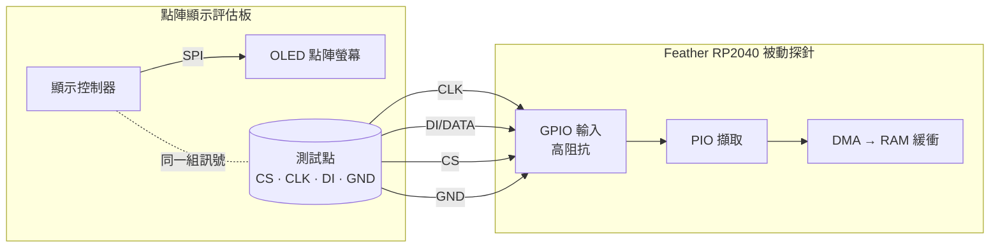

# 2nd-screen — 被動把點陣顯示匯流排鏡到第二螢幕

一片 Feather RP2040 被動高阻抗搭在點陣顯示**評估板**的「控制器 → OLED」SPI 匯流排上（四條線：DI/CLK/CS/GND），把匯流排位元組串流回主機；主機端把它重建成 framebuffer，即時鏡像成評估板的**第二螢幕**。

現有探針全程**只讀、不驅動任何線**。這既是「替點陣顯示器外掛第二螢幕」的小工具。主動改寫第一螢幕另列為評估板實驗方向，硬體前提見下節。

## 範圍

- 高阻抗被動擷取 控制器→OLED 的 SPI
- 把位元組流重建成畫面，鏡成第二螢幕
- 研究自有評估板的第一螢幕回寫；尚未實作或驗證主動回寫

## 安全護欄

1. 現有被動探針只讀、不回寫、不接 MISO；唯一共用的電源連線是 `GND`（**不接 +5V**，避免回灌燒件）。主動回寫需要另設硬體與韌體，不沿用這組並接方式直接驅動。
1. RP2040 先 USB 通電再搭線（永不把活匯流排灌進未通電晶片）。

## 接線（被動、高阻抗）

只接四條，GPIO 全設輸入，不驅動任何線。



| 訊號 | RP2040 GPIO | Feather 絲印 | 作用 |
|---|---|---|---|
| DI（資料） | GP10 | D10 | IN base |
| CLK（時脈） | GP11 | D11 | IN base + 1（必須與 DI 相鄰） |
| CS（選擇） | GP12 | D12 | frame 邊界（低電位有效） |
| GND | GND | GND | 共地（唯一共用電源線） |

> ⚠ Feather 的「Dn」絲印 ≠ GPIO 編號；GP4 未接出（USBBOOT），GP2/GP3 是 SDA/SCL（可能帶上拉，避開）。選 D10/D11/D12 三支相鄰純數位腳。評估板側的測試點依該板資料手冊／原理圖定位，接前用電表復驗（GND 導通、上電量各點對地電壓辨識訊號線）。

## 擷取端韌體（RP2040 PIO tap）

RP2040 的 PIO：以 CS 為 frame 邊界、在 CLK 取樣邊緣讀 DI，湊成位元組推 FIFO，再 DMA 進緩衝，不占 CPU。

```
; PIO 骨架（概念）：CS 低電位期間，於 CLK 上升緣取樣 DI
.program spi_tap
    wait 0 pin CS          ; 等 CS 拉低（frame 開始）
sample:
    wait 1 pin CLK         ; 等時脈上升緣
    in   pins, 1           ; 取樣 DI 一個位元
    wait 0 pin CLK         ; 等時脈回落
    jmp  sample
```

`spi_tap.c` 把三支探針腳全設輸入、以 OEOVER/OD 硬體鎖成永不驅動（純被動），DMA 持續收進 32 KiB ring，USB CDC 以 STP2 binary 小封包傳送（payload 上限 256 B，短尾 flush 目標 1 ms）；擷取不因 USB 傳送停止。預設 SPI mode 0；實測極性不同就改 `.pio` 的 `wait` 邊緣。

### 擷取鏈自測（P-1，晶片內 loopback，無外接跳線）

接真評估板前，先確認**擷取鏈本身是對的**（PIO 取樣 ＋ DMA ＋ USB CDC）。做法是同一顆 RP2040「自己驅動、自己擷取同一組腳」，不接跳線、不接目標板：

- `loopback_test.c` 用 **SIO（一般 GPIO 輸出）** 在 GP10/11/12 打一組已知 mode-0 波形（第 _i_ 個位元組 = `i & 0xFF`），再用**與正式韌體同一支** `spi_tap.pio` 把同一組腳當輸入讀回、比對。
- 關鍵事實：RP2040 的 **PIO 輸入永遠接在 pad 的輸入同步器上，與輸出 FUNCSEL 無關**，故 SIO 驅動輸出、PIO 讀輸入可在晶片內 loopback，毋需外部跳線。
- ⚠ `loopback_test` 會把腳設成**輸出**，**絕不可**在接著目標板時燒；只有 `bus_probe` 與 `spi_tap` 是被動的。

```bash
ninja -C poc/build/spi-tap loopback_test
picotool load -x -f poc/build/spi-tap/loopback_test.uf2
python3 poc/host/usb_probe.py --read 8
```

**實測（Feather RP2040，本機）**[證實]：連續多 round 全 `PASS`，每 round **16384/16384 位元組零不符**，擷取開頭 `00 01 02 … 1f`，與驅動端一致。

```
# loopback_test ready (DI=GP10 CLK=GP11 CS=GP12) — on-chip self-test, no jumper
round 0: PASS  (0/16384 bytes mismatch)
  head: 00 01 02 03 04 05 06 07 08 09 0a 0b 0c 0d 0e 0f 10 11 12 13 14 15 16 17 18 19 1a 1b 1c 1d 1e 1f
```

結論：**PIO 取樣（mode-0、CS 為 frame 邊界、MSB-first autopush）＋ DMA ＋ USB CDC 這條擷取鏈端到端正確。** 自測後重燒回 `spi_tap.uf2`。

<!-- answer: P-1 -->

## 主機端重建：第二螢幕

位元組流依一般點陣 OLED 控制器的「欄定址＋每欄 8 垂直像素」佈局重建 128×64 framebuffer，印成半格 ASCII。

- `live_mirror.py`：**即時第二螢幕**——邊收串流邊重建，終端原地重繪；預設等待完整 `B0..B7` 頁序列（`--page` 同義），`--raw` 顯示最新 1024 B 的未對齊診斷畫面；`--file <cap>` 重播擷取檔。
- `raster.py`：把單一擷取檔還原成一張靜態畫面。

> ⚠ 四線（DI/CLK/CS/GND）**不含 D/C（資料／命令）線**，故位元組流中命令與像素未硬分。**[證實：程式檢查]** 舊版非零密度搜尋無法確認左上角，舊版 `--page` 亦可能跳過頁首低值像素。現版改以完整八頁序列核對位置，不再依像素密度選幀，也不跳過頁首像素。這仍是以已觀察格式重建；面板實際起點與顯示方向尚須對照確認。

**[證實：2026-11-01 裝置擷取與重播]** 本機 `_output/screen1/device-sample-01.txt` 共 96,256 B 匯流排資料，分為 47 個 2048 B dump。逐區塊獨立掃描得到 47 組完整序列：`B0 + 128 B`、`B1 + 128 B`，依此至 `B7 + 128 B`；每頁 marker 相距 129 B。以這個樣本修正：

- 只收整行 1–32 bytes 的偶數長度 hex，忽略 banner／狀態文字。
- 收到完整八頁才更新；新空白畫面可取代舊畫面，不再偏好舊的高密度畫面。
- 不將孤立 `0xBn` 當頁起點，不跳過 `0x00`、`0x10` 等有效像素。
- 空行表示 firmware dump 邊界；不跨邊界拼幀，保留上一個完整畫面直到取得新幀。資料相同時不重繪。

**[限制]** 此顯示格式解碼不涵蓋只有局部頁更新或插入欄命令的其他協定。舊韌體傾印時停止擷取，可能漏掉某次畫面；主機修正不能補回漏掉的 bytes。完整 framebuffer 的頁／欄起點已依捕獲序列定位，與照片的精確像素對齊仍待確認。

### 保留被篩掉的資料與時間資訊

**[證實：程式與回歸測試]** `live_mirror.py` 即時執行時，預設將收到的每個 serial chunk（新版為 binary，舊版為 hex 文字）**先存檔，再解析**，存至 `_output/captures/mirror-<UTC>-<unique>.txt`。含 banner、空行、不合 hex 格式的內容，以及退出時未收完一行的 bytes；不是終端 ASCII 畫面截圖。可以指定檔名（不覆寫既有檔案）：

```bash
# 分別記錄左右移動游標、screensaver 喚醒兩個情境；Ctrl-C 結束並完成紀錄。
python3 poc/host/live_mirror.py --capture _output/pin-cursor-01.txt
python3 poc/host/live_mirror.py --capture _output/screensaver-wake-01.txt

# 替舊的原始擷取建立相同診斷紀錄，輸出新檔並保留來源。
python3 poc/host/live_mirror.py --file _output/pin-cursor-01.txt \
  --capture _output/pin-cursor-reviewed-01.txt
```

旁邊的 `<capture>.events.jsonl` 記錄：serial chunk 的檔案 offset／長度／主機相對時間、完整 frame 的匯流排 offset、實際 render 時間，以及在 dump 邊界、buffer 裁切、退出時**未用於完整 frame 且尚未辨識為命令的 bus bytes**（`unmatched_bus_bytes`，含 `hex`、`bus_offset`、`reason`）。不將這些 bytes 一律判成雜訊或命令；可能包含初始化、其他協定或被截斷的畫面。`non-hex-line` 與 `partial_serial_line` 另留原始 bytes。檔案與事件逐次 flush；收到完整畫面以前亦會存檔。重播紀錄的 `source` 為 `replay`，其時間代表重播速度，不能當成原始擷取時間。

**[證實：舊版程式檢查]** 舊 firmware 等待 2048 B 收滿才送出，且 USB 傾印期間停止 PIO。單次全畫面約 1039 B（含 frame 前綴），可能留在尚未滿的 buffer 裡；主機紀錄只能保存 firmware 實際送達的資料。先前 47 個 dump 各只有一個完整八頁序列，與「約半數更新能鏡像」的觀察相符；**[推測]** 游標／喚醒漏鏡像可能來自等待收滿或漏擷取，尚不能認定為局部更新。終端重繪上限已由約 6.7 Hz 提高為 30 Hz；這不會補回 firmware 沒送出的資料。現已改為持續 DMA 與短週期送出（見下節）；是否需要局部更新解碼仍須依新的完整擷取判定。

### 已知顯示命令註解

**[證實：擷取格式與重播]** 最新 55.3 秒樣本有 217 個完整畫面；每個畫面前固定 7 B 為 `D5 xx 81 yy A6 C0 A0`，其中此樣本 `xx` 為 `6F/7F/8F/9F`，`yy` 為 `FF`。現於 `.events.jsonl` 以每幀一筆 `display_commands` 記錄這五個 prefix 命令及八個 `B0..B7` page 命令。每個項目包含 `bus_offset`、`length`、原始 `hex`、`opcode`、`parameters`、命令名稱與 `decoded` 欄位。

| 命令 | 事件名稱 | 解碼欄位（SSD1306-compatible profile） |
|---|---|---|
| `D5 xx` | `set_display_clock` | `clock_divider=(xx & 15)+1`、`oscillator_setting=xx>>4` |
| `81 yy` | `set_contrast` | `contrast=yy` |
| `A6` / `A7` | `set_display_mode` | `inverted=false/true` |
| `C0` / `C8` | `set_com_scan_direction` | `direction=ascending/descending` |
| `A0` / `A1` | `set_segment_remap` | `remapped=false/true` |
| `B0..B7` | `set_page_start_address` | `page=0..7` |

命令欄位依 [Solomon Systech SSD1306 datasheet，§9 與 §10.1.16](https://www.orientdisplay.com/wp-content/uploads/2020/11/SSD1306.pdf#page=32)。**[推測／限制]** 匯流排內容相容此命令表，尚未確認實際 controller 型號；事件的 `profile` 記為 `ssd1306-compatible`、`recognition` 記為 `validated-frame-boundary`，不是 D/C 硬體取樣。

只有緊貼完整八頁畫面之前、符合上述完整 7 B grammar 的資料才辨識為 prefix；不在像素 payload 中搜尋 opcode，不跨已知 gap 拼接命令。clock／contrast 參數可變，也接受同組命令的 inverse／reverse／remap 變體；其餘未知或不完整 prefix 仍保留為 unmatched。命令即使未改變 framebuffer 也逐幀記錄；此步為註解，不依命令改變鏡像像素或預測下一個 clock 值。`--raw` 未對齊模式不做命令分類。

本機 `_output/captures/mirror-20261101T132401Z-7e7988-known-commands.txt.events.jsonl` 為原擷取的新版註解重播：1,519 B prefix 全部辨識、1,736 個 page marker 已註解，未分類資料為 0 B；217 個 framebuffer 均保留，原始串流副本逐 byte 相同。驗證摘要：`_output/protocol-research/known-commands-validation.json`。

### 第一螢幕回寫：可行性與硬體前提

**[證實：程式與接線文件]** 現有四線探針只是並接到原控制器與 OLED 之間，沒有 mux、輸出隔離或控制權交接線；`spi_tap` 亦以 OEOVER／pad OD 禁止驅動。**[待驗證]** 原控制器在閒置時是否釋放輸出、實際 OLED 型號、命令／資料訊號與邏輯電壓尚未確認，因此目前不能宣稱只改韌體便能回寫。

**[推測：依一般 SPI 電氣模型]** 原控制器可能在無傳輸時仍以 push-pull 驅動 CS、CLK 與 DI。CS 高只表示 OLED 未被選取，不表示控制器輸出已呈高阻抗；RP2040 此時拉低 CS 或切換 CLK／DI，仍可能造成輸出互撞。等待一段無邊緣時間也無法保證原控制器不會在下一刻開始傳輸。此判斷依 [TI SPI 介面說明](https://www.ti.com/document-viewer/lit/html/slla522)；實際板子的輸出行為仍須量測／查原理圖。

可研究的硬體方案：

- **原控制器協作交接**：原控制器停止傳輸並釋放所有相關輸出，明確交出與收回控制權。
- **受控切換路徑**：在控制器與 OLED 之間加入 mux 或具輸出使能的 buffer，確保切換期間與寫入期間不會讓兩個輸出端同時驅動 OLED；須定義切換時序、原控制器在隔離期間的更新處理，以及交還後的畫面／定址狀態同步。
- **先單獨驗證 OLED**：斷開原控制器，用符合電壓的驅動端確認命令、定址、像素資料與時序，再設計共用方案。

**[待驗證：命令／資料與電壓]** 我們的「四條線」包含 GND，並未擷取 D/C。SSD1306 的 4-wire SPI 另有 D/C 訊號，3-wire SPI 則以每字 9 bit 包含 D/C；不能因四線擷取可重建，就假設四線足以正確寫入。須依實際介面補齊控制訊號。既有 DC 電表讀值也不足以確定高／低振幅與輸入容限，不能據此直接把 RP2040 的 3.3 V 輸出接回板子。參考 [SSD1306 datasheet §8.1.3–8.1.4](https://www.orientdisplay.com/wp-content/uploads/2020/11/SSD1306.pdf#page=17)。

**[推測：SSD1306-compatible 解碼]** `D5 6F/7F/8F/9F` 的低四位均為 `F`，對應除頻 16；高四位為 oscillator setting 6／7／8／9。它調整 OLED 內部掃描時脈，並不指定外部 SPI CLK、下次傳輸時刻或可用的寫入窗口。在此命令模型中，寫 GDDRAM 不要求先猜中下一個 `D5` 參數；應保存已觀察的顯示設定，只在實驗需要時改動。原控制器之後重繪也可能覆蓋實驗畫面。實際晶片尚未確認，因此這是條件式解釋，並非對該板子的回寫驗證。依據：[SSD1306 datasheet §10.1.16](https://www.orientdisplay.com/wp-content/uploads/2020/11/SSD1306.pdf#page=40)。

已新增獨立的 [`display_write_test` 與手動送圖指令](../poc/rp2040-spi-tap/display-write-test.md)，準備了 ENS Font「腦哥」128×64 候選畫面；建置／離線驗證、燒錄與 USB HELLO 通過。**[證實：使用者回報]** 使用者送圖收到 `DONE 1024 49dd1d65 HIGH_Z`，但實體畫面未變，並確認目前只知道 `+5V vUSB / GND / ON / CS / CLK / D1`，沒有已確認的 D/C 接點。此 writer 的 GP9 D/C 是未驗證的硬體假設，不能套用於現有接線；DONE 也沒有驗證 OLED 端實際波形或接受命令。現已還原原被動 `spi_tap`，flash verification 通過，USB 恢復 `SPI Tap Stream v2`。

**[待驗證：framing]** 先前 `wiring.html` 的「三線 SPI、D/C 內嵌」說法亦無足夠證據，現已更正。缺少可見 D/C 接點不證明採用標準 9-bit SPI；目前 8-bit 打包的穩定命令／像素序列也不支持直接改用 9-bit writer。下一步須保留 CS 邊界、CLK 邊緣數與 DI bits 以確認真正 framing，並確認控制器／線路電壓與可隔離／交接的接點。`ON` 用途未確認，不猜作 D/C、不驅動；+5V vUSB 維持不接。此階段尚未確認可用現有接點直接回寫。

### 連續串流韌體（STP2）

**[證實：建置與程式檢查]** `spi_tap.c` 使用 byte DMA 寫入 32 KiB、自然對齊的循環 buffer。第二條 DMA channel 在 ring 完成時以硬體重啟資料 DMA；IRQ 只計數 ring 次數，不負責即時 rearm。PIO 持續取樣，USB 由主迴圈以 TinyUSB 可用空間非阻塞送出，沒有每 byte `printf`。三條探針仍保持輸入、OEOVER 強制關輸出與 pad OD；不切到 PIO 輸出功能。

- 每包 payload 最多 256 B；有資料時目標每 1 ms flush 短尾，即使只有單次重繪也不等待下一個畫面。
- 空閒時每 250 ms 送 status heartbeat；主機／USB 排程不提供硬即時延遲保證。
- ring 接近追上尚未消費資料時，保守丟棄該 backlog，累計 `dropped_total` 並遞增 `loss_epoch`。主機太慢或未連線時不能保證零遺失。
- `stall_events` 計數 PIO RXSTALL sticky flag 的觀察次數；不是精確漏 bit／byte 數。若發生 stall，像素／位元組對齊亦可能失效，不能僅靠清 counter 宣稱已恢復。
- 新讀取 session、sequence／offset 不連續、epoch／drop／stall counter 改變或 CRC resync，才中斷主機組幀；USB 封包邊界不會中斷組幀。

線上格式為 32 B little-endian header：`<4sBBHIIIIII`，依序為 `STP2`、type（1=data、2=status）、flags（bit0=session start、bit1=packet RLE）、線上 payload 長度、packet sequence、device timestamp（us）、device byte offset、loss epoch、dropped total、stall events；後接 payload，再接 4 B IEEE CRC32（header+線上 payload）。32-bit counters／時間會回繞，序號與 offset 以模 2³² 檢查。device offset 含已知 ring 丟棄 bytes，且總是按解壓後的原匯流排 byte 數計算；診斷裡的 host `bus_offset` 則只計已交付解碼的 bytes，兩者須區分。

`live_mirror.py` 自動辨識 STP2 或舊版 hex。新 `.bin`／`.txt` capture 都是逐 byte 原始存檔，副檔名不決定格式；terminal ASCII 僅是顯示層。`usb_probe.py --read` 對新版輸出可讀 hex／status，**不是**原始 binary 存檔方式。`raster.py` 仍只讀 hex，binary 重播請用 `live_mirror.py --file <capture>`。

**[證實：Feather RP2040 燒錄與 45 秒實測]** `picotool load -v -x -f` 完成燒錄、逐 byte 驗證及重開，USB product 為 `SPI Tap Stream v2`。本機 `_output/screen1/stream-v2-bench-01.bin` 共 546,447 B 原始 serial 資料，解出 2,710 包、448,849 B 匯流排 payload、432 個完整畫面，終端亦實際重繪 432 次（本次約 9.6 fps）。期間無 CRC／header 錯誤、`dropped_total` 增量 0、`stall_events` 增量 0、loss epoch 固定；開始讀取時有一次途中接入的 transport resync。device offset 跨過多次 32 KiB ring 邊界而保持連續，亦收到 1 B 短尾封包。以每 113 B 重新切割原始檔重播，payload 與 framebuffer 重建一致；統計存於 `stream-v2-validation-01.json`。這是此樣本的量測，不代表任意 SPI 負載均不會 overflow，也尚未獨立確認兩種按鍵情境。

### 可選的逐包無損壓縮（`spi_tap_rle`）

**[證實：程式與離線驗證]** 新增獨立的被動建置 `spi_tap_rle.uf2`，USB product 為 `SPI Stream v2 RLE`（避免 SDK 預設 19 字元限制截斷產品名）。每包仍處理最多 256 B 原匯流排資料，不組 frame、不等待下一個畫面，也不丟棄命令或未知 bytes。原 `spi_tap.uf2` 保留未壓縮格式。PIO、DMA、短尾 flush 與輸入防驅動鎖不變。

壓縮僅使用 byte-run coding：

- flags bit1 (`0x02`) 表示 RLE，僅用於 data 包；status 保持未壓縮。
- RLE payload 前 2 B 是 little-endian 原始長度（1..256），後接 runs。
- tag `0..127`：後接 `tag+1` 個 literal bytes。
- tag `128..255`：後接一個 byte，重複 `(tag & 127)+3` 次（3..130）。
- 包含 2 B 原始長度後仍小於 raw payload 才壓縮，否則送 raw；無法壓縮的內容不膨脹。header 與 CRC 長度不變。
- CRC 先檢查線上 bytes，再做有長度上限的解壓；格式／CRC 壞包會中斷組幀。各包獨立，無上一包字典或上一張 framebuffer 依賴。序號／offset／epoch／drop／stall 的連續性規則保留。
- host `stream_packet.payload_length` 為解壓後的原長度，`wire_payload_length` 為線上長度，`compressed` 標記有無 RLE。原始 capture 仍保存線上 bytes，解壓發生於匯流排解碼之前。

主機 status bar 第二行顯示：

```text
compression saved% min/max/avg=0.0/82.3/70.9
```

這是**節省百分比**，越高越好。min/max 是開啟此 capture 後有效 **data packet** 的最低／最高節省率，包含每包 32 B header 與 4 B CRC：`100 × (1 − (36 + wire_payload_length)/(36 + payload_length))`。avg 則以累計原封包 byte 數加權，`100 × (1 − 累計線上封包 bytes/累計原封包 bytes)`，不是各包百分比的算術平均。raw fallback 算 0%，idle status heartbeat 與壞包不計；尚未收到 data 或重播 legacy hex 時顯示 `--/--/--`。數據累計至這次 host process／重播結束，不因串流 gap 重置。

TTY 在畫面像素未改變時仍每 250 ms 更新 status，不重繪 framebuffer，也不增加 `updates` 計數。等待第一個畫面時顯示 wake/change-screen 提示。原始與壓縮 STP2 檔案重播同樣顯示統計；每次結束時在 `.events.jsonl` 加入 `compression_summary`，記錄有效 data 包數、原／線上封包 bytes 及 min/max/avg。

**[證實：相同封包切法的離線重編碼]** 包含全部 STP2 header／CRC，以下只計有效封包；第一份來源前方 38 B 非封包資料不計入基準：

| 來源 | 原封包總量 | RLE 封包總量 | 減少 | 依原擷取時長換算 |
|---|---:|---:|---:|---|
| 45.026 秒、432 frame | 546,409 B | 159,140 B | 70.88% | 12.14 → 3.53 kB/s |
| 55.318 秒、217 frame | 279,067 B | 96,970 B | 65.25% | 5.04 → 1.75 kB/s |

兩份解壓後匯流排 SHA-256、frame offset／changed 事件及最終 framebuffer 均相同。較低資料率來自第二份畫面更新較少，不代表壓縮能固定達到某個 rate。原始 45 秒樣本逐包 DEFLATE level 1（同樣加 2 B 長度、不划算則 raw）為 178,382 B，比 RLE 的 159,140 B 大；frame-only XOR+RLE 在該樣本也沒有優於直接 RLE，且不保留全部匯流排 bytes，因此本次採無跨包依賴的 RLE。

**[證實：建置與 host 驗證]** 原生 C／Python encoder 逐 byte 一致，覆蓋 772 組 raw／重複／混合資料；測試涵蓋截斷、過長解壓、CRC／sequence gap 與 raw/RLE 混合串流。兩份真擷取重播無損。Feather Release ELF 的 flash code 由 26,052 B 增至 26,728 B（+676 B，使用縮短後的 USB product 字串），static BSS 都是 37,000 B；encoder 直接使用既有 packet buffer，沒有額外壓縮 scratch buffer。host 共 54 項測試通過，含按 byte 加權平均、忽略 heartbeat／壞包，以及相同像素下只更新 TTY status 的檢查。

**[推測／待實測：CPU 與 BLE]** 編碼為單次線性掃描、每包最多 256 B；PIO／DMA 在壓縮期間仍持續收資料。下方真板測試在約 9.6 fps 負載下沒有 drop／stall，支持 RP2040 可負擔此樣本的壓縮工作；尚未獨立量測新增 CPU 時間或測出最大可承受負載。約 3.5 kB/s 不是 Bluefruit 的實測吞吐量，且仍超過 9600 baud 8N1 的 960 B/s 上限。UART／BLE bridge 仍待實作與量測。

重現離線驗證（純 Python 標準庫）：

```bash
python3 poc/host/benchmark_compression.py _output/screen1/stream-v2-bench-01.bin \
  --seconds 45.025662 --out _output/compression/replay-rle.bin
python3 poc/host/live_mirror.py --file _output/compression/replay-rle.bin
```

`--out` 不覆寫既有檔。benchmark 會比對原始／解壓 bus hash、frame 事件與最終 framebuffer，輸出 JSON；本次結果在 `_output/compression/bench-rle-validation.json` 與 `known-commands-rle-validation.json`。

啟用需先停止正在讀 serial 的舊 host process；更新程式後重新執行 Python 才會載入新 decoder。舊 decoder 不認得 RLE flag，不能接壓縮韌體：

```bash
export PICO_SDK_PATH=$HOME/pico-sdk
cmake -S poc/rp2040-spi-tap -B poc/build/spi-tap -G Ninja -DPICO_BOARD=adafruit_feather_rp2040
ninja -C poc/build/spi-tap spi_tap_rle
# 先 Ctrl-C 停止目前 live_mirror，再燒錄；兩種韌體都保持被動輸入。
picotool load -v -x -f poc/build/spi-tap/spi_tap_rle.uf2
python3 poc/host/live_mirror.py
```

**[證實：RLE 安裝與真板擷取]** 已依使用者要求燒錄 `spi_tap_rle.uf2`，picotool flash verification 通過，USB 正常列舉為 `SPI Stream v2 RLE`。更新前 serial port 已無其他 reader，無需終止既有 capture。第一個 20 秒檢查只有 80 個正常 status heartbeat；第二次擷取收到真正畫面資料，在 pseudo-terminal 執行新版 `live_mirror.py` 確認狀態列：

- 30.077 秒、289 frame／289 次重繪，約 9.61 fps。
- 1,802 個有效 data 包；未壓縮等價量 365,144 B，實際 104,555 B，即 12.14 → 3.48 kB/s。
- status 顯示 `compression saved% min/max/avg=0.0/82.3/71.4`；avg 精確值為 71.366%。最小 0% 包含不適合壓縮的小 raw 包。
- 沒有 CRC／header／壓縮解碼錯誤，沒有 stream gap，`dropped_total` 與 `stall_events` 增量都為 0。

原始擷取為 `_output/compression/live-rle-20261101T234620.bin`，旁有 `.events.jsonl`；實際終端輸出在同名 `.terminal.log`，摘要為 `_output/compression/live-rle-status-validation.json`。此為這次畫面／負載的量測，不是 BLE 或任意 SPI 負載的保證。需還原時燒錄原 `spi_tap.uf2`；新版 host 同時支援 raw 與 RLE。

### 用照片建立像素參考，再核對 SPI 起點

**[證實：2026-11-01 本機轉換]** `~/Downloads/screen1.heic` 可取樣成 128×64 的視覺參考，匯出 1024 B 垂直欄打包資料。**[推測]** 此照片的格距約為 `(18.25, 18.15)` 個照片像素，帶輕微傾斜；以下 origin 是候選畫布 `(0,0)` 的像素中心，**不是已確認的面板左上角**。照片無清楚的面板邊界，黑色邊界仍有整數像素位移的不確定性。

```bash
# HEIC/PNG 等格式用本機 ImageMagick 解碼；若輸入 8-bit binary PGM 則只需標準庫。
python3 poc/host/photo_reference.py ~/Downloads/screen1.heic \
  --out _output/screen1/reference \
  --origin 458.85 130.38 --pitch 18.25 18.15 --shear=-0.004

# reference.hex 可直接交給既有靜態檢視器。
python3 poc/host/raster.py _output/screen1/reference.hex

# 用「同一個畫面」的真實擷取核對各頁的候選資料起點。
python3 poc/host/compare_reference.py capture.txt _output/screen1/reference.bin \
  --mask _output/screen1/reference.mask.bin > _output/screen1/comparison.json
```

輸出 `.bits.txt` 每行為從左到右的 128 個像素，共 64 行；`.bin` / `.hex` 的位址是 `page*128+x`，bit 0 為該頁最上列。它是**預期像素參考**，不含命令，也不宣稱是實測的線上位元順序。`.pbm` / `.preview.pgm` 供目視檢查，`.json` 記錄來源雜湊與取樣參數；`.mask.bin` 排除亮度不確定的像素，但不代表幾何位置已確認。照片及衍生檔留在忽略版控的 `_output/`。

比較工具以遮罩後的像素 Hamming distance 排出每頁候選位址，附前後各 8 B 以查找頁／欄命令；位址單位是解碼後的**匯流排 bytes**。頁面各自比對，可能來自不同重繪，不能僅憑最低誤差就宣稱鎖定一個完整 frame。可用 `--shift-x N --shift-y N` 檢驗照片黑邊的候選位移；平移新露出的像素不參與比對。

**[待驗證]** 已收到裝置 SPI 樣本並依頁序列修正同步規則；照片參考與同一畫面的精確比對、欄偏移與面板顯示方向仍待確認。舊版 2048 B dump 之間不能視為無縫匯流排；新版 STP2 則依序號、byte offset、loss epoch 與 CRC 決定連續性。

驗證工具：`python3 -m unittest discover -s poc/host -p 'test_*.py' -v`（含鏡像與照片參考的回歸測試）。

## 量測與真機結果

沒有示波器也能定案：`bus_probe.c` 讓 RP2040 用**真正的輸入門檻**硬體計 CLK 上升緣——「數得到邊緣」直接等於「正式 tap 讀得到」。純被動，可安全搭在活匯流排上。每秒一行：`# alive  CLK rising/s=<n> (total=<n>)  sample DI=<0/1> CLK=<0/1> CS=<0/1>`。

**量測記錄**（bus_probe + spi_tap，評估板）

| 量測 | 值 | 備註 |
|---|---|---|
| CS 對地（DC 電表） | `3.6V`[證實] | idle-high |
| CLK 對地（DC 電表） | `1.8V`[證實] | DC 讀值；不等於已確認的數位訊號振幅 |
| `sample CS`（開機、靜態） | `1`[證實] | idle-high，證明探針有接、共地正常 |
| `CLK rising/s`：靜態畫面 | `0`[證實] | write-on-change：靜態不 clocking |
| `CLK rising/s`：切換畫面 | `8312`/重繪（峰 `16624`）[證實] | 每次重繪一突發，total 單調累積 2.03M→2.18M |
| 真擷取（spi_tap，切畫面 32s） | `12,480 B`[證實] | 垂直欄打包；`raster.py` 還原出可辨識畫面字形 |

**實跑經過**（host build：`brew install picotool ninja`、`~/pico-sdk` shallow clone + tinyusb、cmake/ninja；`picotool load -x -f` 軟體進 BOOTSEL 成功）：

1. **評估板關機時**：三線恆 0、零邊緣——因匯流排無人驅動（非接線問題）。排除接線假設的關鍵：開機後 `sample CS` 立刻讀到 `1`。
2. **評估板開機**：靜態 `rising/s=0`、`CS=1`；切畫面時 `rising/s` 跳到 **8312/重繪**（峰 16624），`total` 單調累積。**結論：本次接線能取樣 CLK；更新行為符合 write-on-change。** 每次重繪約 8312 邊緣 ≈ 一張 128×64 全畫面（8192 bit）。先前由 DC 電表 1.8 V 直接推為訊號振幅並斷言不需電平轉換，證據不足；能被動讀取不代表可用 3.3 V 安全回寫。
3. **真擷取**：block 由 16384 調小到 2048 B（bench／第二螢幕低延遲），切畫面擷得 **12,480 B** 原始垂直欄像素，`raster.py` 以 128 欄 × 頁重繪，**肉眼可讀出評估板畫面字形**——被動搭四線即可即時旁觀顯示內容，**於真機證實**。

| 觀察到 | 結論 |
|---|---|
| 切畫面時 `rising/s` **跳起來**、靜態歸零 | 讀得到，且為 write-on-change（→ 第二螢幕可行） |
| 畫面更新但 `rising/s` **一直 0** | 準位太低（1.8V < V_IH）或接觸問題 → 加電平轉換/比較器 |
| 靜態也**持續很高** | 連續刷新（無 GDDRAM）→ 改連續資料率模型 |

<!-- answer: P-2 -->
<!-- answer: P-4 -->

## 資料率與刷新模型

只搭到「控制器寫入」這一種流量；面板自身的連續掃描在控制器內部，不上 SPI 線。本機實測為 **write-on-change**（靜態 `rising/s=0`，切畫面才突發）——即控制器自帶顯示記憶體（GDDRAM）：

- 一張全幀 128×64 ＝ 1024 B 像素 ＋ 少量頁指令 ≈ **~1 KB**，與實測「每次重繪約 8312 邊緣 ≈ 8192 bit」相符。
- 其餘時間匯流排閒置；真機若為局部更新（只重畫變動區），每次突發只會**更小**——第二螢幕只會更輕鬆。
- 取樣餘裕：PIO 可達 sysclk（125 MHz），對上幾 MHz 的匯流排遠非瓶頸。


<!-- answer: P-5 -->
